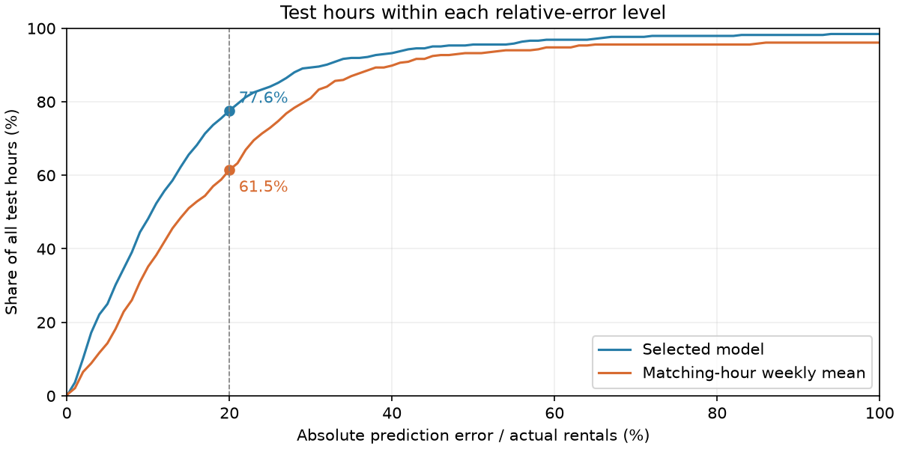

# Seoul Bike Demand Prediction

**Predict system-wide bicycle rental counts one hour ahead from known dates and completed rental/weather observations.** This project compares models, tunes the strongest candidates, evaluates one final choice, and exposes it through a local web service.

## 1. Problem and data

**The prediction supports analysts studying hourly bicycle activity across the Seoul system.** At 17:00, it estimates rentals during 18:00–19:00 using observations completed through 17:00; the latest source row covers 16:00–17:00.

The Seoul Bike Sharing Demand dataset contains 8,760 hourly records and 14 fields, covering December 2017 through November 2018. It supplies rental counts, eight weather measurements, date/holiday information, and operating status. The [data guide](data/README.md) records the UCI source, Kaggle reference, attribution, and download verification.

The output estimates rental events under normal operation. The current service replays historical requests against this fixed dataset. Target dates and holidays are known; weather inputs come from completed observations. The project assumes records describe hour-start intervals and become available when their hour ends.

## 2. Approach and main results

**Across 384 normal-operation test hours, 77.6% of model predictions were within 20% of actual rentals, compared with 61.5% for the matching-hour weekly-mean rule.**

~~~mermaid
flowchart LR
    A["Inspect data and build historical inputs"] --> B["Compare Ridge, forest, and boosting"]
    B --> C["Tune the two strongest families"]
    C --> D["Choose on development validation"]
    D --> E["Fit once; evaluate later test hours"]
~~~

The experiment compared 22 configurations using the same three validation rounds. Validation weeks span all 12 observed months; the final model is fitted on all 7,910 development targets. The selected gradient boosting model combines known target times, recent rentals, and past weather values/changes to adapt its estimates to the observed conditions. Notebook section 7.1 measures reliance on these input groups using development validation.

### 2.1 Prediction errors compared with the weekly mean

**The model was closer to actual rentals than the weekly-mean rule in 239 of 384 hours (62.2%).** This supports its reference value for most operating hours in this test, beyond directly reusing matching historical counts.

| Method | Hours within 20% of actual | Mean hourly percentage error |
| --- | ---: | ---: |
| Selected gradient boosting | 77.6% | 21.3% |
| Mean of matching weekday/hour counts from the previous 1–4 weeks | 61.5% | 35.8% |

Percentage error is the absolute prediction error divided by actual rentals for that hour. The grouped bars compare hours within ±10%, ±20%, and ±30%, each out of all 384 test hours. For example, with 1,000 actual rentals, ±20% means a prediction between 800 and 1,200. These ranges describe results; model selection uses validation MAE.

Actual rentals averaged about 675/hour. Mean absolute error was 85.25/hour for the model and 128.19/hour for the rule, a 33.5% reduction. This gives the count error its volume context.

**Low-volume hours need closer attention:** the 13 hours below 100 actual rentals averaged about 74 rentals/hour and a mean absolute prediction error of 95 rentals/hour. The overall comparison therefore includes a weakness at low volumes. Final testing covers November 15–30, 2018; the [detailed performance analysis](docs/IMPLEMENTATION_DISCUSSION.md#71-relative-errors-and-reference-value) explains the volume groups and comparison scope.

Development validation can train on months later than a held-out week; final testing uses a model fitted only on earlier targets. These results measure the stated periods.

## 3. Review the existing results

**Open [model_development.ipynb](model_development.ipynb) to inspect the executed development workflow and saved outputs.** The notebook records the calls that generate its tables and charts.

| What to review | Notebook sections |
| --- | --- |
| Data checks, patterns, inputs, and validation design | 1–4 |
| Initial models, parameter-search effects, final selection, and input-group importance | 5–7.1 |
| Final-test scores, predictions, and error groups | 8–9 |
| Every initial and tuned candidate | 10 |

For individual scores and settings, inspect [metrics.json](reports/metrics.json) and [validation.csv](reports/validation.csv). The [actual/predicted timeline](reports/figures/replay.png) shows when errors occurred. The detailed [report index](docs/IMPLEMENTATION_DISCUSSION.md#72-reports-for-detailed-checks) explains the other generated files.

## 4. Reproduce the experiment

**Prepare the environment once, then choose the notebook route to replay development or the batch route to generate a saved service model.** Both routes call the same project functions and use the same fixed protocol.

The setup supports Windows PowerShell and Ubuntu bash. Run project commands from the project root (the directory containing `pyproject.toml`). Install [uv](https://docs.astral.sh/uv/getting-started/installation/) for your operating system first if `uv --version` is not recognized.

**Windows — PowerShell** (`winget` is Windows-only):

~~~powershell
winget install --id astral-sh.uv -e
~~~

**Ubuntu — bash**:

~~~bash
curl -LsSf https://astral.sh/uv/install.sh | sh
~~~

If `curl` is unavailable, use `wget -qO- https://astral.sh/uv/install.sh | sh` instead. After installation, reopen your terminal so the updated PATH takes effect, then check `uv --version` and return to the project root.

**Both platforms:** use these same commands to install Python 3.11, create the virtual environment, install the locked dependencies, and prepare the data. The training, testing, and service commands below also work in both PowerShell and bash. Create a separate `.venv` on each operating system; do not copy the Windows environment to Ubuntu.

~~~sh
uv python install 3.11
uv sync --locked --python 3.11
uv run --locked python scripts/download_data.py
~~~

`uv sync` creates `.venv` and installs the project and its development dependencies. The final command downloads or verifies the fixed CSV using that environment's Python. Each `uv run` command uses `.venv` for its process, so a separate shell-activation step is unnecessary.

Optional manual activation in PowerShell:

~~~powershell
.\.venv\Scripts\Activate.ps1
~~~

If PowerShell blocks activation because script execution is disabled, continue using the `uv run` commands above; activation is optional.

Optional manual activation on Ubuntu (bash):

~~~bash
source .venv/bin/activate
~~~

If data setup fails, check the error message: a missing `scripts/download_data.py` means you should return to the project root; `Data setup failed` with a connection or certificate error requires checking access to the UCI download URL printed by the script. The downloader uses only Python's standard library, so these network errors are not caused by missing project dependencies.

### 4.1 Replay development in the notebook

**Open the English notebook, choose the project's .venv Python kernel, and run all cells from the beginning.** Select .venv/Scripts/python.exe on Windows or .venv/bin/python on Linux/macOS.

This generates data analysis, model comparisons, tuning charts, input-group importance, and final-test scores directly from the CSV. The fitted model remains in the notebook kernel; tuning, feature-importance, and performance figures are saved under reports/figures. Prior model/report files are not required. Allow several minutes; runtime varies by machine.

### 4.2 Run batch training and export

**Use this route to generate models/model.joblib and the standard CSV/JSON reports.** It reruns model comparison, tuning, final fitting, and evaluation without a notebook UI.

~~~powershell
uv run --locked bike-train
uv run --locked pytest -q
~~~

The expected selected configuration is gradient boosting with W2, with validation MAE around 121.32 and test MAE around 85.25. Batch training replaces generated model/report files. Run the tests after export: the API test requires the saved model.

## 5. Test the web service

**The service loads models/model.joblib; generate it with section 4.2 when starting from a fresh checkout.** Choose either local startup or Docker, then send the example request from another terminal.

### 5.1 Start locally

**Launch the API on localhost using the saved model and fixed CSV.**

~~~powershell
uv run --locked uvicorn seoul_bike.api:app --host 127.0.0.1 --port 8000
~~~

Keep this terminal running. Open [http://127.0.0.1:8000/docs](http://127.0.0.1:8000/docs) in your browser for the interactive API documentation, or [http://127.0.0.1:8000/health](http://127.0.0.1:8000/health) to check model readiness. The root URL (`http://127.0.0.1:8000/`) has no route and returns HTTP 404 with `{"detail":"Not Found"}`; this is expected. To make a prediction in `/docs`, expand `POST /predict`, click **Try it out**, enter `{"issued_at":"2018-11-16T17:00:00+09:00"}`, and click **Execute**. A 503 response means the model is unavailable: run section 4.2, then restart the service.

Interactive replay accepts issue times from 2017-12-08 00:00 through 2018-11-30 22:00 (Asia/Seoul), including training-period trials. `used_in_training` and `evaluation_scope` distinguish those trials from held-out evaluation. The `/docs` request example uses a valid historical issue time instead of the current date; `/health` reports the loaded model's inclusive time range. Prediction responses include `actual_rentals` from the target-hour CSV row, `absolute_error` in rentals/hour, and `absolute_percentage_error` in percent (null when actual rentals are zero). `actual_operating` indicates whether the recorded target hour was operating. Actual values are looked up after prediction and are not model inputs; shutdown-hour comparisons do not measure normal-operation performance.

### 5.2 Start with Docker

**With Docker Engine running, build and start the image containing the code, fixed CSV, and saved model.**

~~~powershell
docker build -t seoul-bike-demand:v1 .
docker run --rm -p 127.0.0.1:8000:8000 seoul-bike-demand:v1
~~~

### 5.3 Send the example request

**For either startup route, call the service in a second terminal.**

~~~powershell
uv run --locked python scripts/predict_example.py
~~~

The example sends `POST /predict` with:

~~~json
{"issued_at": "2018-11-16T17:00:00+09:00"}
~~~

A local HTTP check on November 16, 2026 returned HTTP 200 for both health and prediction. The prediction response included:

~~~json
{
  "predicted_rentals": 1554.2845177480015,
  "target_start": "2018-11-16T18:00:00+09:00",
  "model_id": "seoul-bike-v1-c17"
}
~~~

This excerpt shows the prediction, target hour, and saved model used; the full response also includes the interval end, observation cutoff, and normal-operation assumption. `GET /health` reports readiness; [localhost /docs](http://127.0.0.1:8000/docs) provides the interactive API reference. Exact accepted times, response fields, and errors are described in the [API contract](docs/IMPLEMENTATION_DISCUSSION.md#81-request-response-and-errors).

For an optional hosted service, follow the [Cloud Run recipe](docs/DEPLOYMENT.md) after account and budget approval. It reuses this Docker image. Cloud execution and a hosted test URL are pending.

## 6. Code and detailed documentation

**The notebook presents the experiment; the shared package and independent tools support execution.** src/seoul_bike contains data preparation, modeling, batch retraining, and the API. scripts contains standard-library data-download and HTTP-call tools. Dependencies are in pyproject.toml/uv.lock, and Dockerfile builds the service image.

| Detail needed | Reference |
| --- | --- |
| Problem scope, intended use, and evidence limits | [Project brief](docs/PROJECT_BRIEF.md) |
| Source fields, examples, distributions, and observed patterns | [Data analysis](docs/DATA_ANALYSIS.md) |
| Exact features, splits, model settings, API contract, and function locations | [Implementation](docs/IMPLEMENTATION_DISCUSSION.md) |
| Dataset source, attribution, and download checks | [Data guide](data/README.md) |
| Optional cloud deployment, authenticated calls, and cleanup | [Deployment recipe](docs/DEPLOYMENT.md) |
